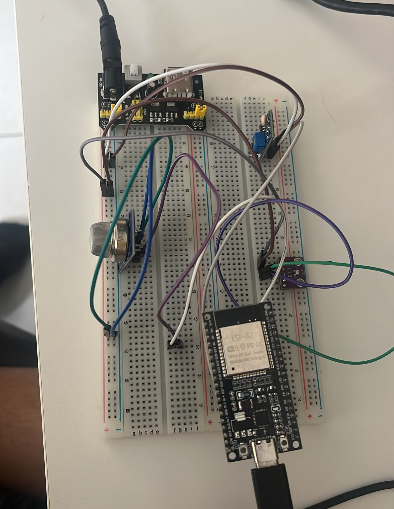

# 🌦️ Estação Meteorológica

## 🎥 Vídeo de demonstração

[Assistir ao vídeo no YouTube](https://youtu.be/_8sZFWW9weA)

Sistema de monitoramento meteorológico desenvolvido como projeto acadêmico do curso de Ciência da Computação da UNIP. O projeto integra um ESP32 programado em MicroPython, uma API desenvolvida em Python com Flask, um banco de dados SQLite e uma interface web para visualizar as medições.

## 📸 Imagem do projeto



## 🎥 Demonstração

[Assista ao vídeo de demonstração do projeto](gifProjeto.mp4)

## 📌 Funcionalidades

- Leitura de dados dos sensores conectados ao ESP32.
- Conexão do ESP32 à rede Wi-Fi.
- Envio das medições para o servidor por requisições HTTP.
- Recebimento e validação dos dados por uma API Flask.
- Armazenamento das medições no banco de dados SQLite.
- Exibição da última medição na página principal.
- Atualização automática dos dados exibidos.
- Consulta do histórico das últimas 100 medições.

## 🧰 Tecnologias utilizadas

- **ESP32** — dispositivo responsável pela leitura e envio dos dados.
- **MicroPython** — programação do ESP32.
- **Python** — desenvolvimento do servidor.
- **Flask** — criação da aplicação e das rotas da API.
- **Flask-CORS** — configuração de acesso entre origens.
- **SQLite** — armazenamento das medições.
- **HTML5** — estrutura das páginas.
- **CSS3** — estilização da interface.
- **JavaScript** — comunicação com a API e atualização das informações.

## 📁 Estrutura do projeto

```text
Projeto-2-Unip-termodin-mica-/
├── main.py             # Código MicroPython executado no ESP32
├── app.py              # Servidor Flask e API
├── estacao.db          # Banco de dados SQLite
├── estacao.sqbpro      # Arquivo do projeto do banco
├── index.html          # Painel principal
├── historico.html      # Página de histórico
├── script.js           # Atualização dos dados do painel
├── historico.js        # Consulta e exibição do histórico
├── style.css           # Estilos das páginas
├── Imagem1.png         # Imagem do projeto
├── gifProjeto.mp4      # Vídeo de demonstração
└── README.md           # Documentação do projeto
```

## ⚙️ Como executar

### 1. Pré-requisitos

- Python 3 instalado no computador.
- ESP32 com MicroPython instalado.
- Arquivos do projeto disponíveis no computador e no ESP32, conforme sua função.

### 2. Preparar o servidor Flask

Abra o terminal na pasta do projeto e crie um ambiente virtual:

```bash
python -m venv .venv
```

No Windows, ative o ambiente:

```bash
.venv\Scripts\activate
```

Instale as dependências:

```bash
pip install Flask flask-cors
```

Inicie o servidor:

```bash
python app.py
```

A API será iniciada na porta **5000** e ficará disponível na rede local.

### 3. Configurar o ESP32

No arquivo `main.py`, configure os dados da rede Wi-Fi e o endereço IP do computador que está executando o Flask:

```python
WIFI_NOME = "NOME_DA_REDE"
WIFI_SENHA = "SUA_SENHA_DO_WIFI"
IP_SERVIDOR = "IP_LOCAL_DO_SERVIDOR"
PORTA = 5000
```

Substitua os valores de exemplo pelos dados corretos da sua rede. O ESP32 e o computador que executa o Flask precisam estar conectados à mesma rede. O ESP32 também utiliza o módulo/driver `bmp280` para a comunicação com o sensor BMP280.

Depois de configurar, execute `main.py` no ESP32. O programa conecta ao Wi-Fi, realiza as leituras disponíveis e envia os dados ao servidor periodicamente.

### 4. Acessar a interface web

Com o Flask em execução, abra o arquivo `index.html` no navegador. Para consultar as medições anteriores, abra `historico.html`.

> **Atenção:** os arquivos JavaScript da interface utilizam o endereço local da API. Para acessar o servidor por outro dispositivo, confira se o endereço configurado nos arquivos JavaScript corresponde ao IP do computador que está executando o Flask.

## 🔌 API

O servidor disponibiliza as seguintes rotas:

| Método | Rota | Descrição |
|---|---|---|
| POST | `/dados` | Recebe e armazena uma nova medição. |
| GET | `/dados` | Retorna a medição mais recente. |
| GET | `/historico` | Retorna as últimas 100 medições. |

### Exemplo de dados enviados

A rota `POST /dados` recebe um objeto JSON com os campos da medição:

```json
{
  "temperatura": 25.5,
  "umidade": 60.0,
  "pressao": 1013.2,
  "qualidade_ar": 120,
  "luminosidade": 450,
  "pluviometria": 0.0
}
```

A API verifica se os campos são numéricos antes de armazenar os dados. Os campos `qualidade_ar` e `luminosidade` também precisam ser números inteiros.

## 🔄 Funcionamento geral

1. O ESP32 inicia e conecta à rede Wi-Fi.
2. O código MicroPython realiza as leituras dos sensores disponíveis.
3. Os dados são enviados por HTTP para a rota `POST /dados` da API Flask.
4. O Flask valida as informações recebidas.
5. As medições válidas são armazenadas no banco SQLite, com data e hora.
6. A interface web consulta a API e apresenta os dados.
7. A página de histórico permite visualizar os registros anteriores.

## ⚠️ Observação sobre os sensores

No código atual do ESP32, temperatura e pressão são obtidas pelo BMP280, enquanto qualidade do ar e luminosidade são lidas pelas entradas correspondentes. Umidade e pluviometria aparecem como `None` no código do ESP32. Entretanto, a API Flask exige valores numéricos para todos os seis campos. Para que o envio seja aceito, esses campos precisam receber valores numéricos de sensores ou a validação da API deve ser ajustada para aceitar campos sem leitura.

## 🎯 Objetivo acadêmico

O projeto tem como objetivo aplicar conhecimentos de programação, desenvolvimento web, comunicação entre dispositivos, criação de APIs e persistência de dados, integrando hardware e software em um sistema de monitoramento meteorológico.

---

**Projeto acadêmico — Ciência da Computação | UNIP**
